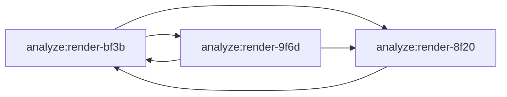
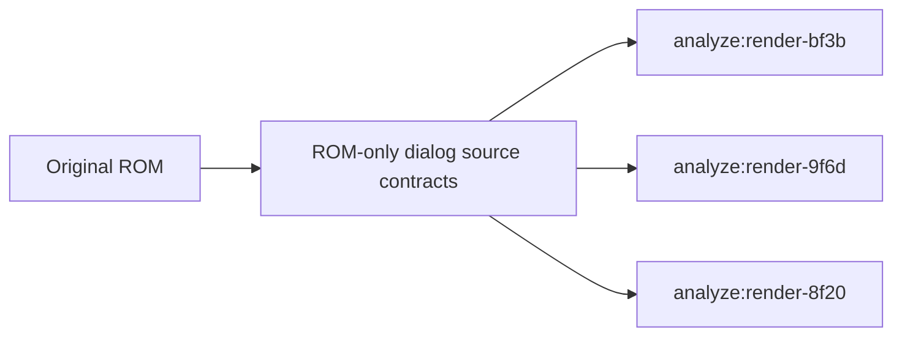

# Generator dependency inventory

Initial snapshot: 2026-10-31, using the generator cache after delivery
`9167d7ff`, before the single-writer cleanup described below.
This inventory maps recorded reads to recorded writers and identifies shared
tool modules. It does not run generators or prove that a clean checkout can
rebuild every artifact. Current work remains in
[PROJECT-STATUS.json](PROJECT-STATUS.json).

## Repeat the inventory

```sh
node tools/generator-dependencies.mjs
node tools/generator-dependencies.mjs --json .cache/generator-dependencies.json
```

The first command prints a short summary. The second also writes the full
graph, cycle members, dependency groups, shared tools, producer gaps and
source classifications to
an ignored cache file. Run from the project directory.

The tool uses the same command selection as the release check: render and
VM analysis, extraction and probe commands, followed by `plan:dialog` and
`docs:progress`. It reads `.cache/release/generators/` and checks each record
against current files using the existing release-cache validator.
Commands without records remain visible as missing observations.

## Recorded snapshot before the single-writer cleanup

| Measurement | Count |
|---|---:|
| Release generators | 769 |
| Current cache records | 769 |
| Missing or stale records | 0 |
| Other npm commands outside this graph | 35 |
| Distinct recorded output files | 1,564 |
| Producer-to-consumer command dependencies | 3,520 |
| File references behind those dependencies | 4,520 |
| Dependencies on a command later in the current release order | 598 |
| Recorded cycle groups | 1 |
| Generators in that cycle | 38 |
| Output files with multiple recorded writers | 2 |
| Generators with no recorded writes | 2 |
| Artifact inputs without a recorded producer in this graph | 1,936 |

A backward dependency is not itself proof of a failed current release:
checked-in artifacts supply the existing starting state. It does show why
the current command order is not a sufficient reconstruction plan.
The full JSON groups mutually dependent commands before ordering the groups.
It does not provide an executable order inside a cyclic group.

## Historical source-confirmed cycle

The initial 38-command cycle included the dialog/render analyses and several
task opcode analyses. A smaller cycle was visible directly in
[analyze-render-bf3b.mjs](../tools/analyze-render-bf3b.mjs),
[analyze-render-9f6d.mjs](../tools/analyze-render-9f6d.mjs) and
[analyze-render-8f20.mjs](../tools/analyze-render-8f20.mjs):



Arrows point from the producer of a report to its consumer. For example,
the 9F6D analysis read the BF3B report to check caller windows; BF3B read
the 9F6D report for the unpacking proof. Reordering commands alone could not
remove these mutual reads. The five edges in this smaller cycle have now
been replaced by direct source checks, as described below.

## Recorded outputs are not a complete ownership map

Of the 1,936 artifact inputs without a recorded producer, 1,875 have the
`analysis/render-task-script-opcode-` prefix. The two Script52 generators
have no recorded writes in this snapshot.

The source explains this gap:
[task-script-opcode-artifacts.mjs](../tools/task-script-opcode-artifacts.mjs)
uses [writeArtifactIfChanged](../tools/write-artifact.mjs). That helper reads
an existing file and skips the write when its final bytes are identical.
The cache therefore records a read but no output write for that execution.
Other gaps include reports from commands outside the selected release
generators and retained input assets. A missing recorded writer does not
mean an artifact is unused or safe to remove.

Directory listings, existence checks, overwritten self-inputs and unexecuted
branches do not become dependency edges here. Shared-tool counts include
transitive module loads; they are not direct-import counts.
The graph is therefore a record of observed dependencies, not a complete
static ownership or bootstrap proof. Intended Script52 ownership is now
listed separately as described below. Generated artifacts remain versioned.

## Shared tool modules

The most widely used tool modules in these records are:

| Module | Generators reading or loading it |
|---|---:|
| `tools/rom.mjs` | 723 |
| `tools/disassemble.mjs` | 690 |
| `tools/pinned-task-source.mjs` | 633 |
| `tools/task-control-source.mjs` | 632 |
| `tools/task-partial-source.mjs` | 627 |

These shared inputs explain why moving a common helper can affect hundreds
of generator records. A directory reorganization should follow an explicit
dependency and import review rather than treating scripts as independent.

## Single-writer cleanup

`analyze:render-task-native-random-opcode` now owns the two source reports:

- `analysis/render-task-native-opcode-c51f.json`
- `analysis/render-task-native-opcode-c560.json`

At the initial snapshot, both that command and
`probe:render-task-native-random-opcode` called `emitTaskNativeRandomOpcode`
for native IDs 3E and 63. The roles are now separated
in the [analyzer](../tools/analyze-render-task-native-random-opcode.mjs),
[probe](../tools/probe-render-task-native-random-opcode.mjs) and
[source builder](../tools/task-native-random-opcode-source.mjs).

The source builder shares complete report construction between the emitter
and the read-only `verifyTaskNativeRandomOpcodeSource` function. Both load
the ROM, check its identity and compute the original proof and source windows
afresh. The verifier compares the whole expected report with the existing
JSON, including its proof, windows, identity and graph flags.

The probe verifies both sources before writing either native report. It
never repairs a missing or changed source report. Original fixture checks
and native report generation remain in the probe; the analyzer remains the
source-report writer. Regression tests intercept probe writes and require
the two native outputs to match their existing bytes. They also reject
changed ROM identity, source windows, proofs and graph flags, missing or
malformed sources, and a wrong ROM before any native output is written.

Delivery checks compare all four report hashes against the pre-change
baseline and repeat the dependency inventory after the release check.
Their results are recorded in HANDOFF.md.

Follow-up snapshot on 2026-10-31: both source reports have the analyzer as
their sole recorded writer; the probe writes only its two native reports.
The multiple-writer output count fell from two to zero, with all 769 cache
records current. All four report hashes and lengths match the pre-change
baseline. The graph still contains the same 38-command cycle.

## Intended Script52 ownership

[script-opcode-outputs.mjs](../tools/script-opcode-outputs.mjs) defines the
paths used by both Script52 emitters in
[task-script-opcode-artifacts.mjs](../tools/task-script-opcode-artifacts.mjs).
It derives the per-ID paths from
[script-opcode-specs.json](../tools/script-opcode-specs.json) and includes
the generic opcode and separate continuation contracts.

| Intended owner | Reports | Count |
|---|---|---:|
| `analyze:render-task-script-opcode` | Source contracts | 939 |
| `probe:render-task-script-opcode` | Native contracts | 939 |

The inventory reads these definitions without importing the emitters or
running proofs. It rejects declarations whose command differs from
`package.json`, duplicate output paths and invalid script IDs. Regression
checks compare the complete declared set against the retained Script52
reports, including the generic and continuation outputs.

Schema version 2 adds `intended_ownership` to the JSON inventory. Its
`definitions` retain command, definition module, ID-list input and output
paths. Each output lists its intended command, recorded writers and
recorded input consumers. Counts distinguish a write by the intended owner,
missing owner writes and writes by another command. Declared paths can
explain missing recorded producers without being inserted into the observed
graph. Existing `counts`, `edges`, cycles and dependency groups continue to
describe recorded activity only.

The 2026-10-31 inventory attributes all 1,878 Script52 reports to these two
commands. None has a recorded write in the unchanged-report cache. This
explains 1,878 of the 1,936 recorded producer gaps, leaving 58 outside this
declaration's scope. The earlier count of 1,875 covered only per-ID names
with the `render-task-script-opcode-` prefix; it excluded the generic source
and the two continuation reports.

Both emitters still recompute proofs and reports before calling
`writeArtifactIfChanged`. Identical final bytes still skip the write.
Release-cache records, validation and invalidation semantics are unchanged;
the inventory does not manufacture output observations in that cache.
Delivery compares all 1,878 report hashes and lengths with their baseline.

## Sources of the remaining 58 inputs

[GENERATOR-INPUT-SOURCES.json](GENERATOR-INPUT-SOURCES.json) records the
source review of the 58 inputs outside the Script52 declarations. It lists
every path, its source category, producer tool and npm command where one
exists, source evidence and ROM or recording prerequisites. Prerequisites
are not a complete dependency list. This catalogue classifies existing
inputs; it is not a complete output manifest for the listed tools.

| Category | Files | Source |
|---|---:|---|
| Generated outside the selected graph | 54 | 27 legacy analyzers, decoders and extractors |
| Recording-dependent reports | 3 | Explicit recording and merge tools |
| Retained input with no current writer | 1 | Palette range list |
| Unclassified in this snapshot | 0 | Every remaining path has a source category |

Of the 27 ordinary generator tools, 24 have npm commands outside the
render/VM selection. They produce the original entry and opcode listings,
task, heap, frame, state, slot and motion reports, script data and frame
profiles. Three tools have no npm command:
[analyze-motion-helper-81b4.mjs](../tools/analyze-motion-helper-81b4.mjs),
[analyze-motion-helper-c9e0.mjs](../tools/analyze-motion-helper-c9e0.mjs)
and [extract-slot-motion-direction-data.mjs](../tools/extract-slot-motion-direction-data.mjs).
Their relevant outputs are two assembly listings and motion direction data.
The AC analyzer is outside this graph but already runs as the release
check's separate AC-source step; its missing graph edge does not mean that
the release fails to check it.

The three recording-dependent reports require more than ROM bytes:

| Report | Producer | Required observations |
|---|---|---|
| `analysis/rom-code-observed.json` | [rom-code-coverage.mjs](../tools/rom-code-coverage.mjs) | Mesen scenario executions; merges into retained instruction states and the data reads in banks 80/81 |
| `analysis/rom-reads.json` | [rom-reads.mjs](../tools/rom-reads.mjs) | `.cache/rom-reads.bin`; merges into retained read ranges |
| `analysis/rom-vram.json` | [rom-vram.mjs](../tools/rom-vram.mjs) | `.cache/rom-vram/*.json`, including recorded screen uses; also reads ROM and the palette list |

The palette list, `analysis/rom-palettes.json`, describes bounded palette
tables plus observed direct CGRAM transfers. Its retained scope and the
palette sections of [ROM-FREE.md](ROM-FREE.md) identify this mixed origin.
No current tool writes it. The palette extractor and ROM/VRAM mapping tools
read it; `extract:vm-palettes` produces a different file. Preserve the
checked-in list as an input until an explicit replacement producer is
established. This review does not establish the absent recorder's code or
claim that the list can be reconstructed from current recordings.

The inventory adds `input_sources` beside its observed graph and intended
Script52 ownership. It verifies the catalogue's command bindings and source
evidence snippets without executing those tools. The snippets identify
reviewed source locations, not a static parser proof of writes. Each
remaining input retains its recorded consumers and classification. Newly
encountered paths stay explicitly unclassified; catalogue paths no longer
in the gap set are listed separately. Regression tests cover these cases,
duplicate paths, false retained-input producers and command drift.

All 58 original observed gaps remain visible. Classification does not add
cache output records, graph edges, release generators or bootstrap steps.
At that classification delivery, the 38-command cycle and existing command
order were unchanged. Source
classification explains the current gaps but does not establish a complete
reconstruction plan or permit removal of retained artifacts.

## ROM-only checks for BF3B, 9F6D and 8F20

[render-dialog-source.mjs](../tools/render-dialog-source.mjs) now provides
the complete 9F6D/9E65 and 8F20 source contracts to their analyzers and
BF3B. It has no file I/O and does not import any analyzer or report. Every
call checks the complete ROM identity, decodes fresh instructions and
recomputes the typed stack proof with full reachable-instruction coverage.
9F6D includes its actual 9E65 callee and full 256-byte offset table; 8F20
retains the fixed WORD decoder restrictions. No proof result is cached.

The two selected caller windows are decoded directly from the ROM and
compared against the pinned complete 936C owner window. Both analyses use
the same source ranges. BF3B consumes the fresh complete subgraph proofs,
including source windows, code and instruction counts and protected stack
requirements, instead of trusting the two emitted reports.



The original JSON and assembly report formats remain byte-identical.
Report paths retained in their provenance fields identify related source
evidence; those strings alone are not file-read dependencies. The 9F6D
analyzer still compares its freshly decoded 9E65 window with the separate
A9B2 source report. At that stage, BF3B's other report dependencies remained
in place; subsequent groups are described below.

The first delivery's regression tests denied reads of all three former
cycle reports while running each analyzer, captured all six outputs and
compared every emitted byte with the retained reports. These tests now
cover the expanded group below. Changed ROMs fail before any write. Direct contract
tests compare complete proofs, windows and the offset table, then modify a
returned graph and verify that the next call recomputes fresh results.
Existing source and native behavior tests remain part of release selection.

That delivery's refreshed inventory after release verification confirmed exactly five
removed command/file edges and no added edges. No report-read edge remains
between these three analyzers. 9F6D and 8F20 leave the cyclic group, reducing
it from 38 to 36 commands; BF3B remains in that group through other reports.
Command dependencies fall from 3,521 to 3,516, file dependencies from 4,518
to 4,513, and backward dependencies from 598 to 596. All 769 cache records
are current, with no stale entries. All six JSON/assembly hashes and byte
lengths match the pre-change baseline.

The comparison is recorded in `.cache/logs/dialog-cycle-graph.json`, with
hash results in `.cache/logs/dialog-cycle-hashes.json`. The release check
passed 12 tests in two selected files with no failures or skips. Details
and full log paths are in HANDOFF.md.

This bounded cleanup does not establish a complete bootstrap order or remove
other cyclic dependencies. Generated artifacts remain versioned and
generator order is unchanged.

## ROM-only field and transfer contracts

The shared source module also supplies the complete 9022/8FF5,
905E/8FF5/A954 and 8F3A/8EFE/B0A1 graphs. BF3B now recomputes those graphs
instead of reading their three reports. Their analyzers decode selected
936C callers directly against the same pinned owner window. The 905E
analyzer obtains its 8FF5 window from the shared source decoder rather
than reading the 9022 report. Together these replace seven report-read
edges within this four-command group.

Each graph retains its original decoder policy, full reachable-instruction
coverage and typed-stack proof. The two field graphs share one 8FF5 decoder.
The transfer policy restores the paired PHP/PLP entry widths and checks
them independently in the typed-stack proof. Standalone 8FF5, A954 and
8EFE proofs remain available to their analyzers; the transfer table remains
16 data bytes, separate from code. Stack requirements remain four bytes
for 9022, five for 905E and six for 8F3A.

The existing external report checks remain: 9022 compares its helper,
selected prefix and request/callback/reset owners with 8FBA; 905E compares
A954 with A98E; 8F3A compares B0A1 with the input-flow source report.
Provenance paths remain in emitted reports even where a file read has been
replaced. No runtime/native equations or report formats change.

Fresh signed 0140 polls and the B0A1 baseline comparison remain explicit
external observation boundaries. Structural stack closure does not prove
wait termination, a counter change, DMA completion, interrupt chronology
or complete dialog ownership. All three reports retain
`actual_termination_proven: false`.

That delivery expanded the regression tests to deny reads of the six former
cycle reports while running all six analyzers, comparing every JSON and
assembly output byte. They also compare the complete and standalone proofs, callers,
decoder width transitions and transfer table with the retained contracts.
The baseline covers twelve report files, including 9F6D and 8F20 because
their common source module changed. New proofs are recomputed for every
call; no cache records or generator ordering rules are changed.

That release comparison confirmed exactly seven removed edges and none added.
No internal report-read edge remains among BF3B, 9022, 905E and 8F3A. The
three callee analyzers leave the cyclic group, reducing it from 36 to 33
commands; BF3B remains cyclic through other dependencies. Command
dependencies fall from 3,516 to 3,509, file dependencies from 4,513 to 4,506,
and backward dependencies from 596 to 593. All 769 cache records are current.
All twelve report hashes and byte lengths match the baseline.

The release passed 19 tests in two selected files with no failures or skips.
The comparison and hash results are `.cache/logs/dialog-fields-graph.json`
and `.cache/logs/dialog-fields-hashes.json`; full log paths are in
HANDOFF.md. Other cyclic dependencies remain, so artifacts
stay versioned and the generator order stays unchanged.

## ROM-only clear, mode and position contracts

BF3B also obtains complete FF79, EF47 and FA92 proofs from the shared source
module instead of reading their reports. Their three analyzers check 936C
caller fragments directly against the pinned complete owner window. This
replaces six mutual report-read edges while preserving external source
comparisons and emitted report formats.

FF79 decodes its root and all ten transitive helper windows in their
established dependency order, including FA3E, AD92 and every actual render
callee. The complete typed graph retains 862 bytes, 401 instructions and
28 protected stack bytes. Its analyzer still compares the complete ordered
dependency descriptors with BE6D; source ranges come from explicit ROM
contracts rather than being discovered by reading the FF79 report.

EF47 includes EF47/F25A/F1FA and all six actual audio helpers. Its decoder
keeps the original local PHP/PLP status stack and mixed BYTE/WORD entry
modes. It recomputes the EF47, both F25A entry-width and F1FA proofs: 22,
19, 19 and 15 protected stack bytes. The graph retains 428 bytes and 213
instructions. Audio owner windows remain separate from the graph. The
analyzer still compares all six dependency descriptors and both owner
windows with the audio report, and verifies the original directory data.

FA92 retains its finite 26-byte, 12-instruction leaf proof with two protected
stack bytes. The analyzer still checks its selected F963 field writers
against BE6D. This source reuse does not establish successful allocation or
complete dialog buffer ownership.

The regression tests now deny reads of all nine former cycle reports and
capture eighteen JSON/assembly outputs. They compare every complete proof,
EF47 helper proof, dependency and owner descriptor, and selected caller with
the retained contracts. New drift cases reject altered external BE6D or
audio reports before any write. The extended common module also keeps the
previous 9F6D, 8F20, 9022, 905E and 8F3A output bytes under comparison.

FF79 data loops and WORD 01F8 waits, EF47 directory/payload loops and BYTE
2140 acknowledgements, and all original caller ownership boundaries remain
explicit prerequisites. Structural source closure does not prove device
progress, termination, audible output or scene/frame integration. No native
equations, runtime behavior, cache semantics or generator order change.

The release comparison confirms exactly six removed edges and none added.
No internal report-read edge remains among BF3B, FF79, EF47 and FA92. The
three callee analyzers leave the cyclic group, reducing it from 33 to 30
commands; BF3B remains cyclic through other reports. Command dependencies
fall from 3,509 to 3,503, file dependencies from 4,506 to 4,500, and backward
dependencies from 593 to 590. All 769 cache records are current. All
eighteen report hashes and byte lengths match the pre-change baseline.

The release passed 28 tests in two selected files with no failures or skips.
The graph and hash comparisons are `.cache/logs/dialog-audio-graph.json`
and `.cache/logs/dialog-audio-hashes.json`; full log paths are in
HANDOFF.md. Other cyclic dependencies remain; generated
artifacts stay versioned and no bootstrap order is established.

## Conditional menu and partial text source contracts

[render-menu-source.mjs](../tools/render-menu-source.mjs) now supplies the
ROM-backed A6A5 menu, 91E2/9215 selection and partial 9178/908C contracts.
It declares their source ranges explicitly and has no file I/O. Each call
checks ROM identity, decodes fresh instructions under the routine's
original policy and recomputes its existing proofs. Shared source ranges
retain their original order, overlap checks, BYTE/WORD joins, status pairing
and the source-only 9E54 mode transition.

The menu builder keeps all five helper proofs, four normal-menu entry
proofs and four original-sound entry proofs. Its conditional graph remains
2,304 bytes and 1,088 instructions with 20 protected stack bytes. Both
selection roots retain their all-sound and original-sound proofs over 3,573
bytes and 1,664 instructions, requiring 22 and 28 protected stack bytes.
Fresh 9E1A reset exclusion and the original nonzero-voice conditions remain
part of those proofs. Neither builder establishes full reset closure,
actual termination or a global stack minimum.

The text builder retains the complete local 9178 and BYTE-entry 908C
windows, the 1,306-byte/632-instruction render subset, its 17-byte proof and
the standalone 908C two-byte proof. Task and caller excerpts remain
separate. Its full graph stays open at C1CA, with no native binding and a
null stack minimum. C34A source closure and C1CA prefix bounds do not become
a complete 9178 return proof.

BF3B now consumes the fresh conditional selection and partial text results.
The three analyzers check selected 99EB/936C caller slices against pinned
whole-owner ROM windows. Selection and text use the shared menu source
ranges instead of reading the A6A5 report. This replaces seven reads within
the four-command group. Existing report paths remain provenance fields.

[render-menu-source-reports.mjs](../tools/render-menu-source-reports.mjs)
retains the external report checks against BE6D, 9E1A, input flow, audio and
AD92. It validates ROM identity and complete window descriptors using the
original direct or transitive ownership policy. Its report cache is local
to one verification call; no source proof or release-cache result is cached
there. The 9178 analyzer also retains the separate C34A, C1CA and motion-gate
checks, including their explicit closed/open flags and stack frontiers.

Regression tests deny reads of all twelve former cycle reports and capture
all twenty-four JSON/assembly outputs. They compare complete helper,
conditional and partial proofs, dependencies, caller/task excerpts and
frontier flags; mutating a returned proof cannot change the next result.
New drift cases reject altered external descriptors and false C34A/C1CA
claims before any output write. Runtime behavior, source/native equations,
wait/device observations, retained input classifications and generator
ordering remain unchanged.

The release comparison confirms exactly seven removed edges and none added.
No internal read remains among BF3B, A6A5, selection and 9178. BF3B and
selection leave the cyclic set. The previous 30-command group splits into
a two-command A6A5/audio group and a 26-command task group containing 9178,
C34A, C1CA and task opcode analyses. Thus 28 commands remain cyclic across
two groups; 9178 still has task/report dependencies outside this cleanup.

Command dependencies fall from 3,503 to 3,496, file dependencies from 4,500
to 4,493, and backward dependencies from 590 to 588. All 769 cache records
are current. All twenty-four report hashes and byte lengths match the
pre-change baseline. The release passed 39 tests in two selected files,
with no failures or skips.

Results are in `.cache/logs/dialog-menu-graph.json` and
`.cache/logs/dialog-menu-hashes.json`; full log paths are in
HANDOFF.md. The graph comparison checks membership across
both remaining groups. Artifacts remain versioned, and no complete
reconstruction order is established.

## Direct C46E menu window for the audio analyzer

[analyze-render-audio.mjs](../tools/analyze-render-audio.mjs) no longer reads
the A6A5 report. Its C46E drift check now compares its own decode with
`describeRenderMenuWindow` from
[render-menu-source.mjs](../tools/render-menu-source.mjs). That function
checks ROM identity and decodes the menu-owned `selectedAudioC46E` window
(80:C46E to 80:C4B3) under the original menu policy. It accepts only menu
window names and performs no file I/O. The F007 check against the 9E1A
report is unchanged, as are all audio proofs, the open general C46E
zero-voice return, device and wait boundaries, and the menu analyzer's
external checks against the audio report.

Regression tests run the audio analyzer while denying reads of the A6A5
report and compare both outputs byte for byte. They also reject a changed
ROM and an altered 9E1A F007 descriptor before any write, and they compare
the shared window with the retained A6A5 and audio descriptors.

The inventory comparison confirms exactly one removed edge (A6A5 to audio)
and none added. The two-command A6A5/audio group is gone; one cyclic group
of 26 commands remains around 9178, C34A, C1CA and the task opcode
analyses. Command dependencies fall from 3,496 to 3,495 and file
dependencies from 4,493 to 4,492; backward dependencies stay at 588. All
769 records are current. Both audio report hashes and byte lengths are
unchanged. The release passed 43 tests in two selected files with no
failures or skips. Results are in `.cache/logs/audio-cycle-graph.json` and
`.cache/logs/audio-cycle-hashes.json`.

## Direct C34A and C1CA sources for the 9178 analyzer

[analyze-render-9178.mjs](../tools/analyze-render-9178.mjs) no longer reads
the C34A or C1CA reports. It calls `proveRender9178TaskSources` from
[render-9178-task-source.mjs](../tools/render-9178-task-source.mjs), which
checks ROM identity and decodes the same windows under the same policies as
the C34A analyzer (three windows, REP/SEP tracked) and the C1CA analyzer
(nine windows, all WORD). It has no file I/O. It recomputes the C34A
fixed-callee proof and requires zero external return assumptions and eight
protected stack bytes. It recomputes the typed C1CA frontier and requires
zero external return assumptions. C1CA stays open: not closed, no native
binding and a null stack minimum. The 9178 report keeps both report paths
as provenance fields and takes the C34A stack minimum and the C1CA prefix
stack bound from these fresh results. The motion-gate check is unchanged.

Regression tests deny reads of the C34A and C1CA reports for all twelve
dialog and menu analyzers and compare all outputs byte for byte. A new
contract test compares the fresh C34A proof and C1CA frontier with the
retained reports and the values in the 9178 report. It checks that mutating
a returned result cannot change the next one, and that changed bytes in the
C34A, C2C8, C242, C1CA, F378 and F4CB windows are rejected. The two old
9178 drift cases for altered C34A and C1CA reports are removed, because
9178 no longer reads those reports.

The inventory comparison confirms exactly two removed edges (C34A to 9178
and C1CA to 9178) and none added. 9178, C34A and the child-yield analysis
leave the cyclic set; one group of 23 commands remains: C1CA and 22 task
opcode analyses. Command dependencies fall from 3,495 to 3,493, file
dependencies from 4,492 to 4,490, and backward dependencies from 588 to
586. All 769 records are current. Both 9178 report hashes and byte lengths
are unchanged. The release passed 42 tests in two selected files with no
failures or skips. Results are in `.cache/logs/9178-task-graph.json` and
`.cache/logs/9178-task-hashes.json`.

## Direct interpreter source for the task opcode analyses

The task opcode analyzers no longer read the C1CA report.
[task-interpreter-source.mjs](../tools/task-interpreter-source.mjs) exports
`taskInterpreterSource`. It checks ROM identity and returns, without file
I/O, exactly the C1CA report fields these analyzers used: the WORD-decoded
`interpreterF378` (80:F378 to 80:F393) and `runC1F9` (80:C1F9 to 80:C242)
window descriptors, the 257-byte opcode WORD source at 80:F2B4 and all 256
byte-opcode targets with their classifications. Its results are computed
as in [analyze-render-c1ca.mjs](../tools/analyze-render-c1ca.mjs).

Sixteen analyzers call it directly; the five control-flow analyzers (jump,
zero and nonzero jumps, local call and local return) use it through
[task-control-source.mjs](../tools/task-control-source.mjs). Every check
and report field is unchanged; dependency entries keep the C1CA report path
as provenance. The C1CA analyzer still verifies all task opcode reports,
and its open frontier, unresolved dynamic boundaries, false native-binding
flags and null stack minimum are unchanged.

[task-interpreter-source.test.mjs](../tools/task-interpreter-source.test.mjs)
compares the shared fields with the retained C1CA report, checks that a
mutated result cannot change the next one and rejects changed bytes in the
opcode table and both windows. It runs all twenty-one analyzers with reads
of the C1CA report denied and compares both outputs of each byte for byte.
A probe that denied a report the analyzers really read failed as expected.

The inventory comparison confirms exactly twenty-one removed edges, all
from C1CA, and none added. No cyclic group remains. Command dependencies
fall from 3,493 to 3,472 and file dependencies from 4,490 to 4,469;
backward dependencies stay at 586. All 769 records are current and every
artifact is unchanged. Because task-control-source.mjs is shared widely,
the incremental release reran 647 generators. Results are in
`.cache/logs/task-interpreter-graph.json`.

An acyclic graph does not yet give a reconstruction order: 586 dependencies
still point to a later command in the current release order. Artifacts stay
versioned and the generator order is unchanged.

## Dependency-ordered release generators

[order-generators.mjs](../tools/order-generators.mjs) reorders the release
generators in `package.json` so that every producer runs before its
consumers. It reads the inventory written by `generator-dependencies.mjs`
and uses the observed edges plus the declared Script52 outputs, whose
owners write only changed bytes and therefore record no outputs. The order
is a stable topological sort: among ready generators the earlier position
wins. Other npm scripts and the two fixed final commands, `plan:dialog` and
`docs:progress`, keep their positions. `node tools/order-generators.mjs`
reports the result; `--write` applies it.

Applied once, it moved ten script lines: `analyze:render-audio` before
A6A5, `analyze:render-c1ca` after the task native dispatch analysis, and
four analyze/probe pairs (native opcodes, visit opcodes, visit status
opcodes and script bodies) after the last native task analysis. Backward
dependencies fall from 586 to 0; all other counts are unchanged.
[order-generators.test.mjs](../tools/order-generators.test.mjs) covers
stability, cycle and duplicate rejection, slot filling and declared
outputs.

The release cache keys do not include the order, so the incremental release
reran no generator. A zero backward count shows the order is consistent with
the recorded graph; it does not yet prove that a checkout without generated
artifacts rebuilds them. The user decided on 2026-10-31 that generated
artifacts leave Git once such a rebuild from the ROM is shown to work.

## Rebuild from the ROM and unversioned analysis reports

[rebuild-artifacts.mjs](../tools/rebuild-artifacts.mjs) (`npm run
rebuild:artifacts`) recreates every generated file under `analysis/` and
`assets/`. It runs the npm commands of the catalogued outside-graph
producers in `package.json` order, the three catalogued tools without an
npm script (the 81B4 and C9E0 motion helper listings and the slot motion
direction data), the ROM-only `extract:slot-action-data`,
`extract:slot-target-data` and `extract:motion-postpass-data`, and then the
release generators including `plan:dialog` and `docs:progress`. `--clean`
deletes the generated files first. Seven inputs are never deleted: the
Mesen-dependent `mesen-coverage.json`, `rom-code-observed.json`,
`rom-reads.json` and `rom-vram.json`, the retained `rom-palettes.json`, and
the captured `boot-logo-observations.json` and `room-observations.json.gz`.

Verification in scratch clones at commit 30169e6e:

- Deleting the 3,496 recorded, declared and catalogued outputs and running
  796 commands rebuilt every file byte for byte; `git status` was empty.
  A first attempt without the three tools lacking npm scripts left two
  listings and one asset missing, which made `vm-rom-map.json` differ and
  `extract:vm-tables` and `extract:vm-cartridge` fail.
- Deleting 30 further analysis files outside the graph rebuilt 28; the
  other two were `mesen-coverage.json` (needs Mesen) and
  `slot-action-data.json`, whose ROM-only extract command is now included.
- The final tool deleted 3,528 files and rebuilt them with 799 commands in
  201 seconds; `git status` showed only the not yet committed tool itself.

Following the user decision of 2026-10-31, the 3,475 generated reports
under `analysis/` are no longer versioned; `.gitignore` excludes
`analysis/` except the five recorded or retained inputs there. Generated
runtime data in `assets/` stays versioned for now, because `npm start`
loads it directly and a fresh checkout should stay playable without a
rebuild; removing it is an open user decision. `docs/PORTIERUNGSSTAND.md`,
written by `docs:progress`, also stays versioned as documentation.
[rebuild-artifacts.test.mjs](../tools/rebuild-artifacts.test.mjs) checks
the command sequence, the retained list against the input catalogue and
the ignore rules.
